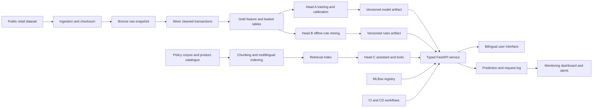

# Architecture

Status: D2 architecture with a verified local FastAPI integration stub. Public deployment and production operational controls remain pending.

## System boundary

One reproducible data pipeline supplies three model heads. Expensive preparation, training, rule mining, and indexing happen offline. The online path loads versioned artifacts and provides low-latency responses through one typed API.

## Offline responsibilities

- Acquire data, verify its checksum, record provenance, and convert it to an explicit Parquet schema.
- Clean transactions and produce auditable before-and-after counts.
- Build point-in-time features and chronological labels.
- Compare and tune retention models, calibrate probabilities, and select a profit-aware threshold.
- Mine association rules and export an indexed static artifact.
- Build the multilingual retrieval index and evaluate it against a predefined golden set.
- Register artifacts and metadata before promotion.

## Online responsibilities

- Load approved model, rule, and retrieval artifacts once at startup.
- Validate every request and response.
- Serve prediction, recommendation, product lookup, policy search, and bilingual chat flows.
- Record structured operational and model inputs for monitoring.
- Expose separate health, readiness, version, and metrics endpoints.

## Design principle

The API does not train models, mine rules, or rebuild the retrieval index on a customer request. Online computation is restricted to validation, inference, indexed lookup, retrieval, tool orchestration, and logging.

## Implemented API boundary

The local service loads all three heads once through FastAPI lifespan management and exposes typed `/health`, `/ready`, `/version`, `/predict`, `/predict/batch`, `/recommend`, `/chat`, and `/metrics` routes. The exact Head A feature contract is validated before inference, Head B exposes its fallback source, and Head C preserves refusal, handoff, citation, and tool-result fields.

The current `/metrics` endpoint is an in-memory integration demonstration. Authentication, durable event logging, Prometheus-compatible telemetry, deployment identity, rate limiting, and the monitoring dashboard remain D4 responsibilities. Retention scoring from a customer identifier remains gated until authenticated customer context is implemented.
